# MoveWise: Learn. Play. Improve.

A free, open-source, offline-first chess app. No ads, no accounts, no trackers, and no network calls for normal use. Your games, ratings, lessons and saved mistakes stay on your device.

**Version 0.8.0.** This is the last planned feature release. See [CHANGELOG.md](CHANGELOG.md) for what is new and [ROADMAP.md](ROADMAP.md) for what is deliberately limited.

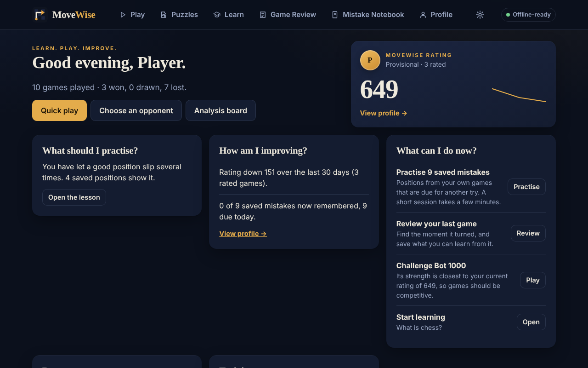

## What you can do

- **Play** against 25 bots (Bot 100 to Bot 2500), or **play with the Trainer**, which warns you before a serious blunder and explains key moments. Trainer games are always unranked.
- **Review** any game with Stockfish on your device: accuracy, key moments, move-by-move explanations at three levels, and one-tap saving of mistakes to the Notebook.
- **Practise your own mistakes** in the **Mistake Notebook**, scheduled with spaced repetition.
- **Solve puzzles** (2,771 checked Lichess puzzles, three-stage hints, a separate puzzle rating, daily puzzle, Puzzle Rush).
- **Learn** in the Academy: 9 courses and 113 interactive lessons with checks and assessments.
- **Track progress** on a local profile with a provisional MoveWise Rating, results, openings and achievements.
- Optionally hear the Trainer's important messages with **spoken coaching** using voices already installed on your device.

Everything works offline after the first visit and can be installed from the browser menu.

## Screenshots

These are real screens from the running app (headless Chromium, dark theme, 1280 by 800). The data comes from sample games played by MoveWise's own bots and then reviewed in the app, imported through the normal import. They are not mock-ups. The voice settings screenshot shows the honest state of a browser that has no installed voices.

| | |
| --- | --- |
| 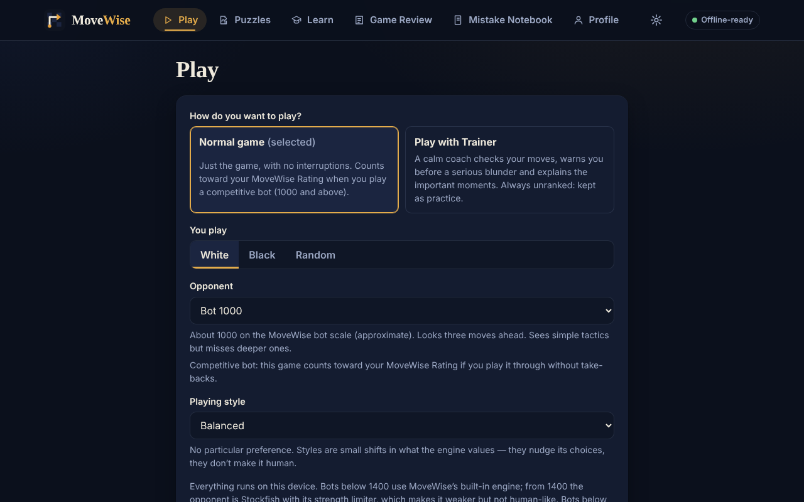 Bot selection with practice and competitive levels | 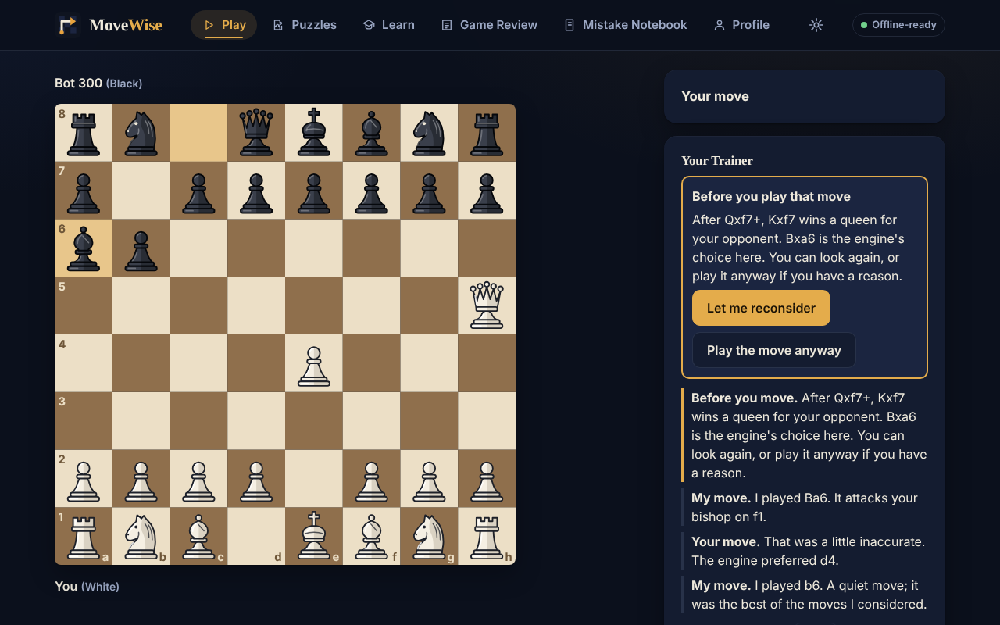 Play with Trainer: a warning before a blunder |
| 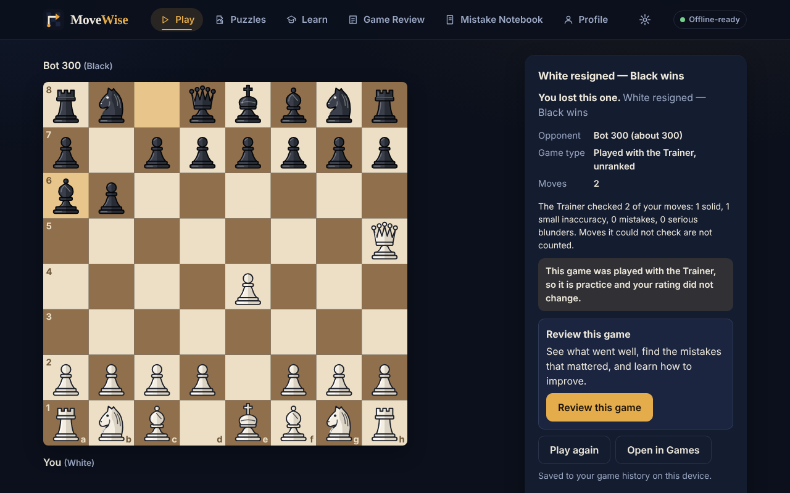 Results screen with the review invitation | 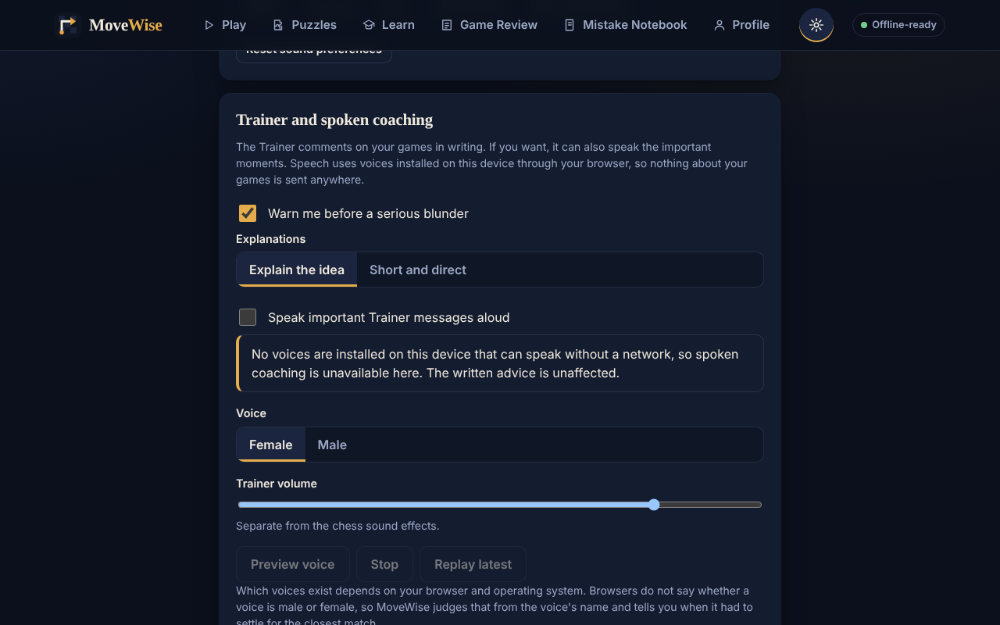 Trainer voice settings |
| 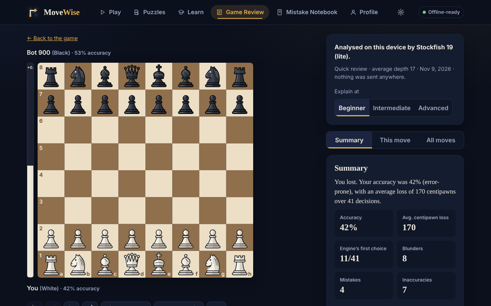 Game Review summary | 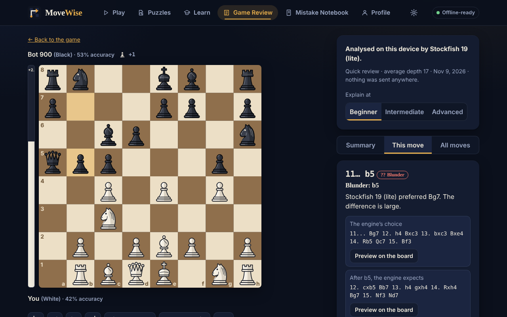 Move-by-move analysis |
| 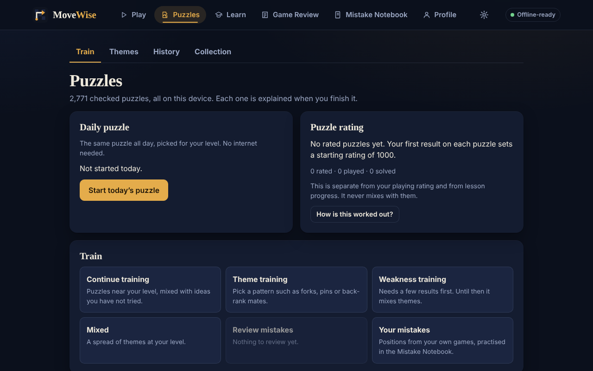 Puzzles | 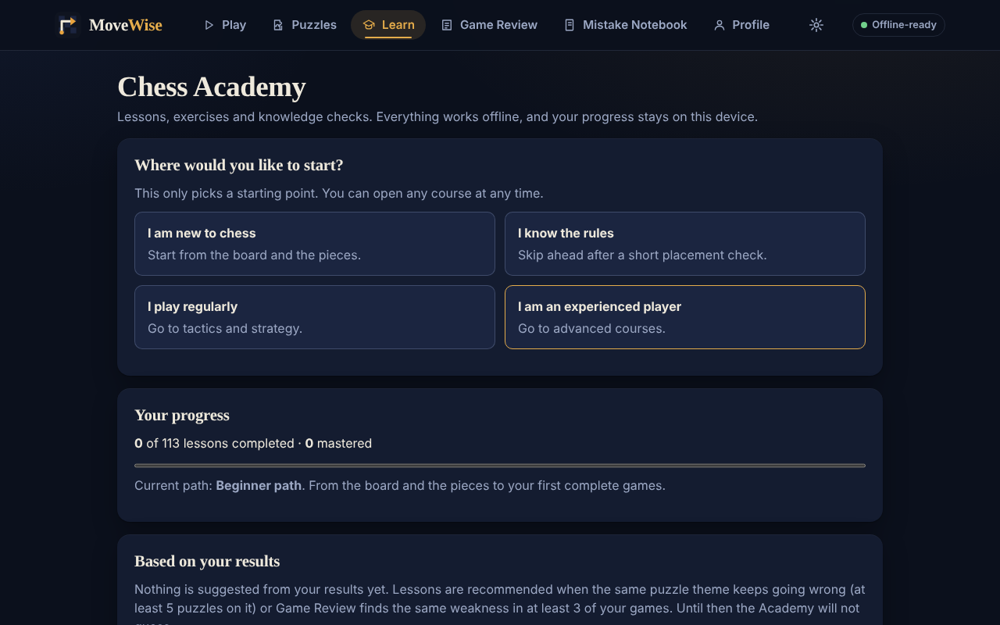 Academy |
| 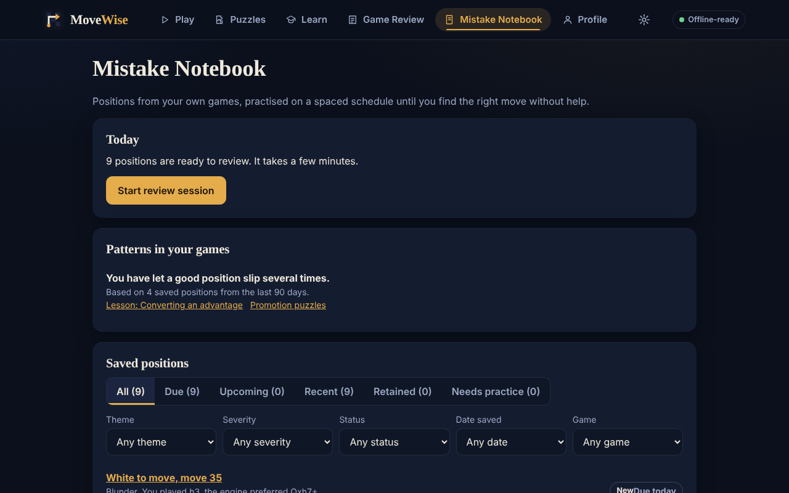 Mistake Notebook | 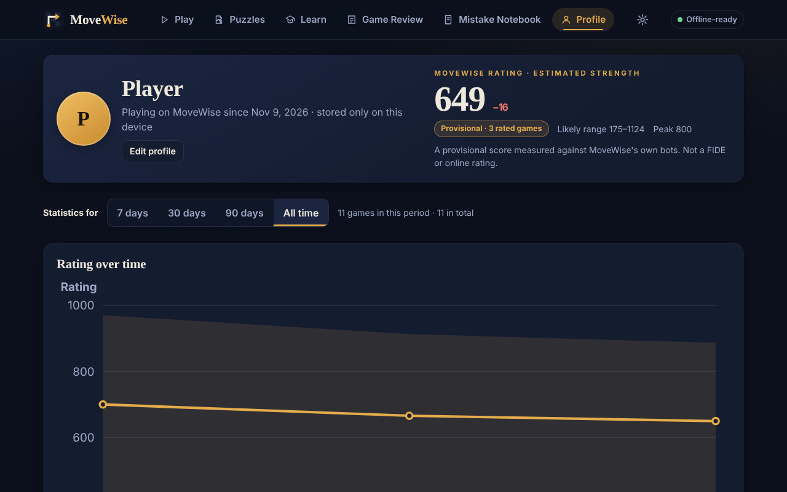 Profile |

## Quick start

```bash
npm ci
npm run build      # bundles the app and the engine worker, generates the service worker
npm run serve      # http://localhost:4173
```

Open the served page once while online; after that the app, including Stockfish, runs offline. To publish it on GitHub Pages see [docs/deploy.md](docs/deploy.md).

Checks:

```bash
npm run typecheck
npm test                    # unit tests (rules, perft, engine, rating, storage, Notebook, Trainer, Academy, bot docs)
npm run test:contrast       # text contrast audit on the main screens, both themes
npm run test:sound          # renders every synthesised sound offline and measures it
npm run check               # typecheck, unit tests, build and all browser tests (needs Chromium: npx playwright install chromium)
npm run test:e2e:trainer    # Play with Trainer, voice settings (fake synthesiser), offline, phone width
npm run test:e2e:notebook   # Mistake Notebook
npm run test:e2e:subpath    # served under /movewise/ like GitHub Pages
npm run test:upgrade        # v0.5 to current IndexedDB upgrade (needs V05_DIR, a built v0.5 release)
```

## Status

| Area | State | Notes |
| --- | --- | --- |
| Chess rules (legal moves, castling, en passant, promotion, draws, undo, SAN, FEN, PGN) | Done, tested | Own rules engine, verified against published perft counts |
| Board (click, drag, touch, keyboard, legal-move dots, promotion picker, flip, 6 board themes) | Done | Original SVG piece set. One set so far |
| Dark and light themes | Done | Dark is the default |
| Play against bots | Done, tested | 25 levels, practice 100 to 900 and competitive 1000 to 2500. See [docs/bots.md](docs/bots.md) |
| Play with Trainer | Done, tested in a browser | Always unranked. See [docs/trainer.md](docs/trainer.md) |
| Spoken coaching | Implemented; tested with a fake synthesiser only | Uses the browser's installed voices. Real voices were not tested on any platform. See [docs/trainer.md](docs/trainer.md) |
| Game Review | Done, tested | Stockfish on the device when available, and the page says which engine ran. See [docs/game-review.md](docs/game-review.md) |
| Mistake Notebook and spaced repetition | Done, tested | See [docs/notebook.md](docs/notebook.md). The schedule has not been tuned on real learners |
| Puzzles | Done, tested | Tactics only. See [docs/puzzles.md](docs/puzzles.md) |
| Academy | Done, tested | 9 courses, 113 lessons. Known limits in [docs/academy.md](docs/academy.md) |
| Profile, MoveWise Rating, achievements | Done, tested | Rating is provisional and not comparable with FIDE or online ratings |
| Sound | Done, tested; not listened to | Synthesised with Web Audio. Measured, but no person has listened to it. See [docs/sound-and-achievements.md](docs/sound-and-achievements.md) |
| Offline PWA | Done, e2e-tested offline in Chromium | Not tested in other browsers or on real devices |
| GitHub Pages | Prepared, sub-path tested locally | The workflow has not been run on GitHub, and no site has been deployed from this project |
| Accessibility | Partial | axe-core: 0 violations over 74 page states in both themes; keyboard, contrast, reduced-motion and layout audits. No screen reader was used. See [docs/accessibility.md](docs/accessibility.md) |
| Clocks and time controls, multi-PV, board editor, more piece sets | Not built | |

## Bots and ratings

The bot numbers are **approximate MoveWise bot ratings**, not Elo, FIDE or online ratings. Bots 100 to 900 are practice only and never change your rating. Bots 1000 to 2500 are competitive. Levels up to 1300 use the built-in engine, and levels 1400 and above use Stockfish with its strength limiter. The evidence behind the numbers, with the games and their limits, is in [docs/bots.md](docs/bots.md). In short: the ordering of the levels is reliable, the spacing is only roughly 100 per step, and the numbers were never measured against people.

## The MoveWise Rating

The rating on the Profile page is a **provisional MoveWise rating**.

- **Method:** Glicko-2. Each finished game is its own rating period, and the rating is recomputed from your saved games, so deleting or importing games keeps it consistent.
- **Opponents:** each competitive bot has an approximate strength (see above) and a wide uncertainty, so one result against a bot moves your rating modestly.
- **What counts:** finished games against competitive bots (1000 and above) from the standard start with no take-backs and at least 4 plies. Practice bots, Trainer games, imported games and games with take-backs are shown as "Unrated" with the reason.
- **Confidence:** "provisional" until at least 10 rated games and a rating deviation of 120 or below.
- **Restart:** "Restart my rating" starts a new rating period without deleting games.
- Competitive, practice and Trainer games have separate statistics. The puzzle rating is a separate track ([docs/puzzles.md](docs/puzzles.md#the-puzzle-rating)).

## The engines

Stockfish 19 (lite, single-threaded, the `stockfish@19.0.1` package, GPL-3.0, unmodified) is bundled and cached for offline use. It powers the Analysis board, Game Review, the Trainer's pre-move check and bot levels 1400 and above. It needs no special server headers. If it cannot start, the app falls back to the built-in engine for analysis and says so; a Stockfish bot level never silently falls back to a weaker engine and instead tells you it is unavailable.

The built-in engine (alpha-beta search, quiescence, hand-tuned evaluation, in a Web Worker) plays bot levels up to 1300. Engine work runs only in Web Workers; cancelling a request terminates the worker so the interface cannot freeze or receive a stale answer.

Stockfish is GPL-3.0. The corresponding source is identified in the app (Settings, Engines) and in `dist/licenses/Stockfish-SOURCE.txt`.

## Offline and privacy

- A service worker precaches every built file and never touches cross-origin requests.
- Games, settings and progress live in IndexedDB. If the browser blocks storage the app says so and falls back to memory.
- The end-to-end tests cut the network after install and assert the app made zero external requests, including during Trainer games with a Stockfish bot.
- No analytics, telemetry, remote fonts, scripts or audio files. Sounds are generated on the device.
- Spoken coaching uses only the browser's built-in speech synthesis with voices installed on the device. Voices that stream from a server are never selected, and MoveWise sends nothing to any speech service.
- Backup export and import is a file on your device.

## How it is built

```
src/audio/      synthesised sounds, sound manager, Web Audio backend
src/chess/      rules: Position (moves, FEN, SAN), Game (history, draws), PGN
src/engine/     evaluation, search, bot ladder (levels.ts), Stockfish client and router, workers
src/notebook/   Mistake Notebook: capture rules, spaced repetition, exercises, insights, storage service
src/trainer/    Trainer: move check, coaching text, speech manager
src/review/     Game Review analysis and explanations
src/academy/    courses, lessons, progress, recommendations
src/puzzles/    puzzle library, solver, rating, daily puzzle, Rush
src/profile/    Glicko-2, MoveWise rating, openings, statistics, achievements
src/storage/    IndexedDB store (with a memory fallback), backup validation
src/ui/         React app: shell and router, board, pages, styles
scripts/        build, static server, calibration, contrast audit, screenshots
tests/          unit tests (node:test via tsx) and tests/e2e/*.mjs (Playwright)
```

Chess logic never imports UI code, and every move that reaches the board is validated by the rules engine.

## Documentation

- [docs/bots.md](docs/bots.md): bot levels, calibration evidence and limits
- [docs/trainer.md](docs/trainer.md): Play with Trainer and spoken coaching
- [docs/notebook.md](docs/notebook.md): Mistake Notebook and spaced repetition
- [docs/game-review.md](docs/game-review.md), [docs/puzzles.md](docs/puzzles.md), [docs/academy.md](docs/academy.md), [docs/sound-and-achievements.md](docs/sound-and-achievements.md)
- [docs/accessibility.md](docs/accessibility.md): accessibility checks and their limits
- [docs/deploy.md](docs/deploy.md): installing, running and deploying (GitHub Pages)
- [docs/TOOLING.md](docs/TOOLING.md): why the toolchain differs from the original brief

## Deliberate differences from the original brief

The brief preferred React + TypeScript + Vite + Tailwind + chess.js + Stockfish + chessground + vite-plugin-pwa. Only React and TypeScript were available offline, so:

| Brief | What is used instead | Consequence |
| --- | --- | --- |
| chess.js | Own rules engine (`src/chess`) | Verified with perft (all six standard suites) and 19 rules tests. Needs ongoing test discipline since it is maintained here |
| Stockfish WASM | Stockfish 19 lite for Analysis, Game Review, the Trainer's move check and bot levels 1400 and above; built-in engine for bot levels up to 1300 | See [docs/bots.md](docs/bots.md) |
| chessground | Own SVG board component | No GPL dependency for the board; fewer features (no arrows/annotations yet) |
| Vite + vite-plugin-pwa | esbuild script + hand-written service worker with a build-hashed precache | Works and is tested offline; no dev-server HMR |
| Tailwind CSS | Hand-written CSS design system with CSS variables | No utility classes |
| ESLint, Prettier, Vitest, axe-core, chart/icon/form libraries | Strict `tsc`, `node:test`, a contrast script, hand-written SVG icons and charts | See [docs/TOOLING.md](docs/TOOLING.md) |

| `@types/react` | Sandbox-only shim in `src/types/react-shim.d.ts` (used by `tsconfig.sandbox.json`) | With a normal `npm install`, `npm run typecheck` uses real types |

After an update is deployed, the app shows "A new version is ready" and updates when you choose, not under you mid-game.

Moving to any of the preferred libraries later is possible, and the module boundaries were kept so each can be swapped independently.

## Licensing

MoveWise is licensed **GPL-3.0-or-later** (chosen so that Stockfish, which is GPL-3.0 and is bundled, and Chessground, if ever adopted, can be combined without a licence conflict). The full GPL-3.0 text is in `LICENSE`, and a copy ships in the app as `licenses/MoveWise-LICENSE.txt`. Stockfish's own licence text ships as `licenses/Stockfish-COPYING.txt`.

Bundled third-party code today: React, React DOM and Scheduler (MIT, licence texts shipped in the app), and Stockfish 19 lite (GPL-3.0, unmodified, from the npm package `stockfish` 19.0.1). See [THIRD_PARTY_NOTICES.md](THIRD_PARTY_NOTICES.md). The piece set, logo and all text are original to this project. The opening names in `src/profile/openings.ts` are standard, uncopyrightable move sequences written for this project. The bundled puzzle pack is a selection from the Lichess puzzle database, released by Lichess under CC0 1.0, and is recorded in the notices with its provenance. Lesson content is original to this project; its puzzle exercises use frozen Lichess CC0 positions.

## Contributing

See [CONTRIBUTING.md](CONTRIBUTING.md).
